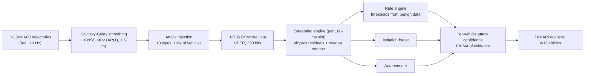
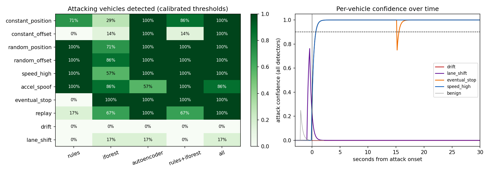

# v2x-bsm-fdi-detector

**Detecting falsified SAE J2735 Basic Safety Messages from connected vehicles.** A stream-processing
detector for roadside units: a physics rule engine (impossible displacement, speed-position and
acceleration inconsistency, jerk, off-road positions) combined with an isolation forest and an
autoencoder that also see cross-vehicle context (footprint overlap, how many vehicles a sender
overlaps). It outputs an attack confidence per vehicle ID. Benign traffic is **real**: 677,465 BSMs
built from the NGSIM I-80 trajectories with realistic GNSS error, UPER-encoded as J2735 `BSMcoreData`.

**Headline (802 test vehicles, 66 attackers, thresholds set on benign data only):**

* **Crude falsification is caught fast.** Fake positions, offsets, speeds, stops and replayed messages:
  every attacking vehicle flagged, median **0.8 s** after onset.
* **Careful falsification is not.** An attacker who keeps its reported motion physically consistent (a
  slowly ramped forward drift, or a smooth one-lane shift) was detected **0% and 17%** of the time. An
  earlier version of the drift attack appeared to be caught 83% of the time; that turned out to be
  the onset step in my own attack, not the detector (Section 4.2).
* **False alarms:** 10.2% of benign vehicles were flagged at some point in the test period (4.6% of
  those not shadowed by an attacker), against a 2% target on the validation period. Traffic got more
  congested later in the recording, and the threshold did not carry over.

---

## 1. Problem formulation

A V2X application such as forward collision warning or cooperative merging trusts the position,
speed and acceleration other vehicles broadcast ten times a second. IEEE 1609.2 signatures prove a
message came from a credentialed vehicle; they say nothing about whether its *content* is true. An
insider with valid credentials (a compromised on-board unit) can therefore inject false data. The
question here is what a roadside unit can catch from message content alone, and what it cannot.

| Bar | Here |
|---|---|
| **Transportation / CAV** | SAE J2735 `BSMcoreData` with its UPER encoding, real freeway trajectories (NGSIM I-80), GNSS error model, misbehaviour taxonomy after VeReMi, per-vehicle detection latency |
| **ML** | Unsupervised only (no attack labels): isolation forest and autoencoder on benign windows; alert threshold calibrated on held-out benign traffic; per-attack ROC AUC |
| **Systems** | Stateful streaming engine (one call per 100-ms slot), KD-tree neighbour search, FastAPI scoring service, CPU-only Docker image, 28k messages/s feature extraction on one core |

---

## 2. Architecture



---

## 3. Methodology

**Benign BSMs.** NGSIM I-80 (Emeryville, CA, 4:00-4:15 pm) gives every vehicle's position at 10 Hz from
video. Raw NGSIM speeds are differentiated positions and very noisy, so each trajectory is smoothed
(Savitzky-Golay, 2.1-s window). Speed, acceleration and heading are recomputed from the smoothed path,
standing in for the CAN-bus values an on-board unit reports. The first and last second of each
trajectory are dropped, because the filter's derivatives are distorted there (they produced false alarms
in an early run). Reported positions get GNSS error: an AR(1) bias (sd 1.5 m, correlation 0.998 per
100 ms) plus 5-cm white noise. Every field is then rounded to its J2735 resolution through a geodetic
round trip.

**J2735 encoding.** `BSMcoreData` consists only of constrained integers and fixed-size strings, so UPER is
each value minus its lower bound in $\lceil\log_2(\text{range})\rceil$ bits: 290 bits, 37 bytes. Part II
and the `MessageFrame` wrapper are not encoded.

**Attacks** (an insider transmitting false content about itself; attack starts 3 s after the vehicle first
appears; 10% of test-period vehicles, types assigned round robin):

| Attack | What is reported |
|---|---|
| constant_position, constant_offset (+25 m) | frozen position, or position shifted forward |
| random_position, random_offset (up to 10 m) | new random position or offset in every message |
| speed_high, accel_spoof | constant 35 m/s; random ±6 m/s² acceleration |
| eventual_stop | frozen position and zero speed (a fake stalled vehicle) |
| replay | another vehicle's messages from 5 s earlier, under the attacker's ID |
| **drift** | extra speed ramped smoothly to +1 m/s over 3 s, position integrated to match |
| **lane_shift** | position shifted one lane (3.7 m) along a smooth 3-s step, heading to match |

The last two are designed to pass every single-vehicle physics check.

**Features.** For each message, relative to the sender's previous one: displacement residual
$|\,\lVert\Delta\mathbf p\rVert - \tfrac{v_t+v_{t-1}}{2}\Delta t\,|$, acceleration residual
$|\Delta v/\Delta t - \bar a|$, jerk, displacement perpendicular to the reported heading, and distance
outside the road. Context: the deepest footprint overlap with any other vehicle in the same 100-ms slot,
and the number of distinct vehicles overlapped in the last 3 s. Overlap is symmetric (a ghost and the real
car beneath it both overlap), but a ghost moving through traffic meets many partners.

**Detectors** (all fitted on the first 200 s, which contain no attacks):

* rules: any residual above 1.5 × its benign 99.99th percentile (with floors), or speed > 60 m/s, |a| > 10 m/s²;
* isolation forest and autoencoder (9 → 16 → 4 → 16 → 9) on log-scaled 1-s window features; a message is
  anomalous above the benign 99.9th percentile score;
* per-vehicle confidence $c \leftarrow 0.75\,c + 0.25\,e$, where $e$ = any detector fired. The alert
  threshold on $c$ is the lowest value that flags at most 2% of vehicles in **benign validation traffic
  (200-300 s)**. No attack data is used for any threshold.

---

## 4. Results ([`results/i80/RESULTS.md`](results/i80/RESULTS.md))



### 4.1 Detection (6-7 attacking vehicles per attack type)

| Attack | Rules | Isolation forest | Autoencoder | All combined | Median time to detect (all) |
|---|---|---|---|---|---|
| constant_position | 71% | 29% | 100% | **100%** | 0.9 s |
| constant_offset | 0% | 14% | 100% | **100%** | 0.8 s |
| random_position | 100% | 71% | 100% | **100%** | 0.8 s |
| random_offset | 100% | 86% | 100% | **100%** | 0.8 s |
| speed_high | 100% | 57% | 100% | **100%** | 0.8 s |
| accel_spoof | 100% | 86% | 57% | 86% | 7.3 s |
| eventual_stop | 0% | 100% | 100% | **100%** | 0.8 s |
| replay | 17% | 67% | 100% | **100%** | 0.8 s |
| drift | 0% | 0% | 0% | **0%** | - |
| lane_shift | 0% | 17% | 17% | **17%** | 12.7 s |

| Detector | Alert threshold (from benign validation) | Benign vehicles flagged | ...not near an attacker | Benign messages in alert |
|---|---|---|---|---|
| rules | 0.60 | 4.3% | 2.3% | 0.06% |
| isolation forest | 0.60 | 9.2% | 3.8% | 0.19% |
| autoencoder | 0.85 | 7.9% | 3.5% | 0.13% |
| all combined | 0.90 | 10.2% | 4.6% | 0.18% |

*"Near an attacker": the attacker's reported position was within 6 m for at least 1 s (476 of 736 benign
vehicles in dense traffic). A ghost sitting on a real car makes that car's context look abnormal too.*

### 4.2 What the numbers say

* **Rules see the moment of a lie; windows make it stick.** A one-off violation (the 25-m jump of
  constant_offset, the speed drop of eventual_stop) fires a rule for one message, which the confidence
  filter rightly ignores as noise. The learned models look at the maximum residual over the last second,
  so the same event produces ten suspicious messages in a row and an alert within a second. This is why
  the autoencoder catches attacks the rules miss.
* **The careful attacks are the real result.** Drift (0%) and lane shift (17%) produce message-level AUCs
  of 0.52-0.57, essentially chance. In free-flowing traffic a ghost one lane over, or a few metres ahead,
  often overlaps nobody, so content checks on their own cannot expose it. My first drift attack added its
  extra speed as a step, which is itself an acceleration spike: the autoencoder caught 83% of those
  vehicles. Ramping the step in over 3 s, as a careful attacker would, took that to 0%. Catching
  consistent lies needs independent evidence: the RSU's own sensors (radar, camera), or cross-checking
  claims against what other vehicles report seeing.
* **Thresholds drift with traffic.** Calibrated for at most 2% of benign vehicles in minutes 3-5, the
  combined detector flagged 4.6% of unshadowed benign vehicles in minutes 5-15, which were more congested.
  A deployed detector would recalibrate per site and time of day.

### 4.3 Throughput (one CPU core)

| Stage | Rate |
|---|---|
| Feature engine (physics + KD-tree context) | 27,676 messages/s |
| Scoring (rules + isolation forest + autoencoder) | 53,464 messages/s |
| UPER encode / decode | 18 / 16 µs per message |

A busy RSU hears a few hundred vehicles at 10 Hz (a few thousand messages per second), within one core's budget.

---

## 5. Layout, reproduce, limitations

```
src/bsmguard/j2735.py      BSMcoreData and its UPER codec
src/bsmguard/data.py       NGSIM loader, smoothing, GNSS error, local tangent plane
src/bsmguard/attacks.py    10 falsification attacks
src/bsmguard/engine.py     streaming feature engine (physics residuals, overlap context)
src/bsmguard/detector.py   rules, isolation forest, autoencoder, confidence, persistence
src/bsmguard/study.py      experiment, calibration, metrics, figures ; api/app.py ; cli.py
tests/ (6 tests: UPER round trip and ranges, geodetic round trip, engine residuals and overlap,
        attack labelling and drift consistency, detector fit/calibrate/persist, API)
```

```bash
python -m venv .venv && .venv/Scripts/activate
pip install torch==2.5.1 --index-url https://download.pytorch.org/whl/cpu
pip install -r requirements.txt && pip install --no-deps -e .
pytest
# NGSIM I-80 pages (data.transportation.gov, dataset 8ect-6jqj) as page_*.csv, e.g. downloaded by
# github.com/faysalchowdhoury/cloud-trajectory-etl-geh-pipeline
bsmguard study --raw path/to/i80_1600          # ~2 min; writes results/i80/ and models/detector.pt
docker build -f docker/Dockerfile -t bsmguard . && docker run -p 8000:8000 bsmguard
```

**Limitations.** One 15-minute recording and 6-7 attackers per attack type, so detection rates are coarse;
attacks are injected, not captured from real compromised units; the GNSS model is simple (no multipath or
outages); no Part II fields or 1609.2 security headers; simulated SUMO/CARLA feeds were not used (real
trajectories were preferred); the service keeps state in one process.

## License

MIT
