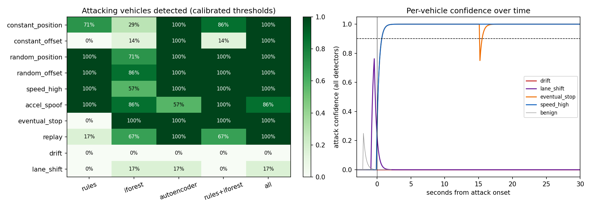

# BSM false-data-injection detection on NGSIM I-80

677,465 BSMs (189,556 benign training, 116,950 benign validation, 370,959 test of which 31,731 falsified); 802 vehicles in the test period, 66 attackers.

## Attacking vehicles detected / median time to detect (s)

| Attack | rules | iforest | autoencoder | rules+iforest | all |
|---|---|---|---|---|---|
| constant_position | 71% / 0.4 | 29% / 2.0 | 100% / 0.7 | 86% / 0.6 | 100% / 0.9 |
| constant_offset | 0% / - | 14% / 0.3 | 100% / 0.6 | 14% / 0.5 | 100% / 0.8 |
| random_position | 100% / 0.3 | 71% / 1.1 | 100% / 0.6 | 100% / 0.5 | 100% / 0.8 |
| random_offset | 100% / 0.3 | 86% / 2.9 | 100% / 0.6 | 100% / 0.5 | 100% / 0.8 |
| speed_high | 100% / 0.3 | 57% / 5.3 | 100% / 0.6 | 100% / 0.5 | 100% / 0.8 |
| accel_spoof | 100% / 1.8 | 86% / 14.3 | 57% / 1.8 | 100% / 3.6 | 86% / 7.3 |
| eventual_stop | 0% / - | 100% / 0.8 | 100% / 0.6 | 100% / 1.5 | 100% / 0.8 |
| replay | 17% / 27.7 | 67% / 10.8 | 100% / 0.6 | 67% / 11.0 | 100% / 0.8 |
| drift | 0% / - | 0% / - | 0% / - | 0% / - | 0% / - |
| lane_shift | 0% / - | 17% / 35.4 | 17% / 12.5 | 0% / - | 17% / 12.7 |

## False alarms (736 benign vehicles in the test period, 476 of them had an attacker's reported position within 6 m for 1 s or more)

| Detector | Alert threshold (set on benign validation) | Benign vehicles flagged | ...excluding those near an attacker | Benign message alert rate |
|---|---|---|---|---|
| rules | 0.60 | 4.3% | 2.3% | 0.06% |
| iforest | 0.60 | 9.2% | 3.8% | 0.19% |
| autoencoder | 0.85 | 7.9% | 3.5% | 0.13% |
| rules+iforest | 0.80 | 8.3% | 3.8% | 0.15% |
| all | 0.90 | 10.2% | 4.6% | 0.18% |

## Message-level ROC AUC of the learned scores

| Attack | Isolation forest | Autoencoder | Rules TPR |
|---|---|---|---|
| constant_position | 0.950 | 0.969 | 0.19 |
| constant_offset | 0.599 | 0.580 | 0.00 |
| random_position | 0.990 | 1.000 | 1.00 |
| random_offset | 0.985 | 1.000 | 0.99 |
| speed_high | 0.946 | 1.000 | 1.00 |
| accel_spoof | 0.971 | 0.946 | 0.41 |
| eventual_stop | 0.998 | 0.868 | 0.00 |
| replay | 0.777 | 0.708 | 0.12 |
| drift | 0.521 | 0.519 | 0.00 |
| lane_shift | 0.572 | 0.535 | 0.00 |

## Throughput (one CPU core)

* feature engine: 27,676 messages/s; scoring: 53,464 messages/s
* UPER BSMcoreData: 37 bytes, encode 18.1 us, decode 16.3 us

